# md-viewer

A desktop reader for Markdown. It opens a `.md` file and shows it the way a
good read-later app shows an article: one sheet of paper, a centered column
of serif text, and nothing else on screen until you ask for it.

It is a native app written in Rust with [egui](https://github.com/emilk/egui).
It renders LaTeX math, Mermaid diagrams, tables and syntax-highlighted code,
and reloads the page when the file changes on disk.

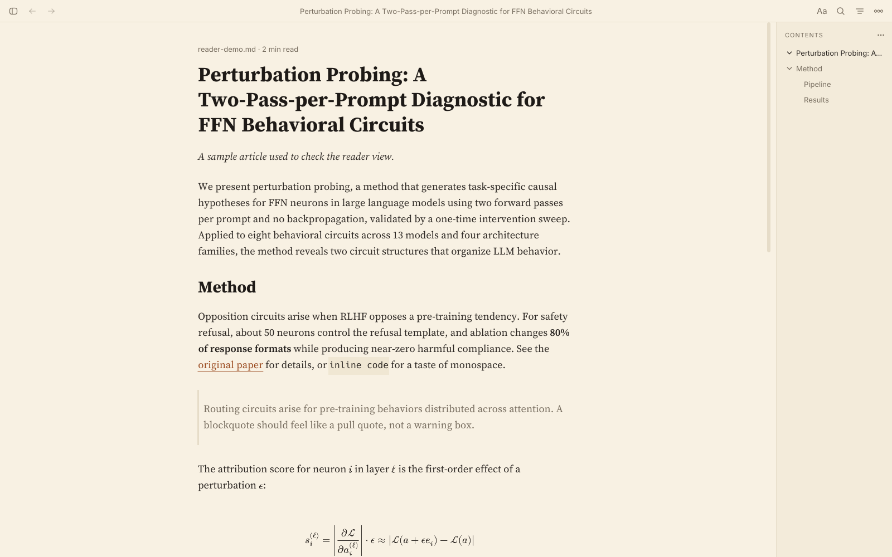

## What it looks like

### Four themes

Paper, Sepia, Dusk and Night. Each one is a single palette that every part of
the window draws from, and body text keeps at least 7:1 contrast on all four.
Press `Ctrl+D` to step through them.

| Sepia | Paper |
| --- | --- |
| 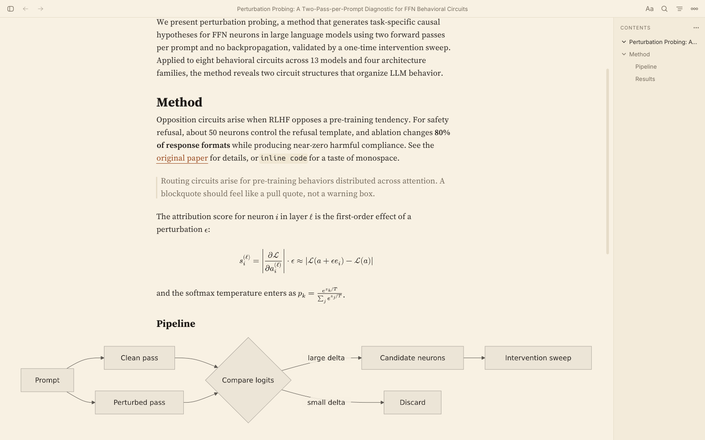 | 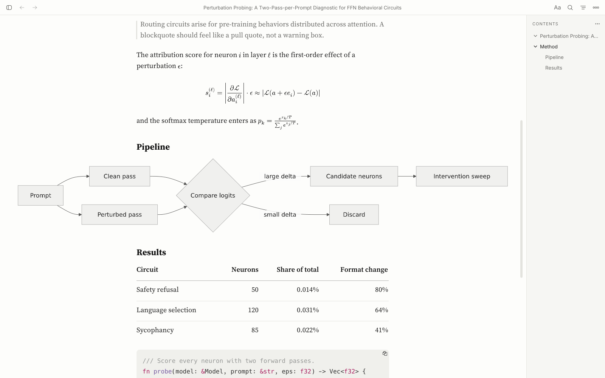 |
| **Dusk** | **Night** |
| 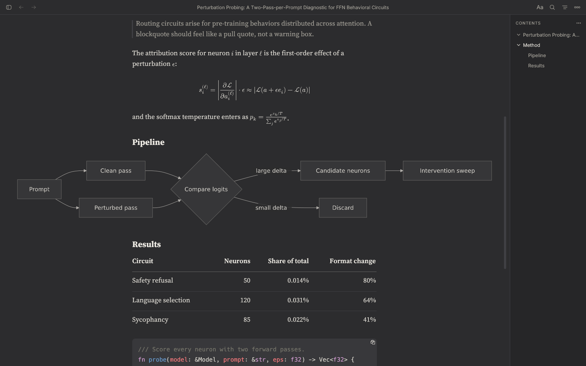 | 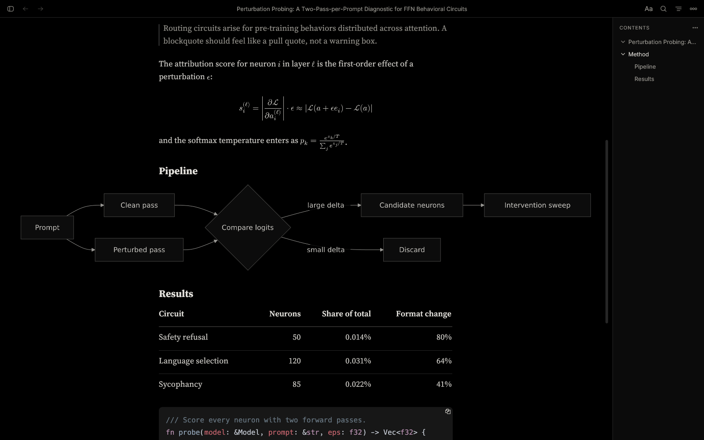 |

### A column as wide as you want

Drag either edge of the text and the column follows, from 280 px up to the
whole window. A small pill shows the width while you drag. Double-click an
edge to go back to the default.

| Dragging the edge out to 1026 px | Narrowed to about 300 px |
| --- | --- |
| 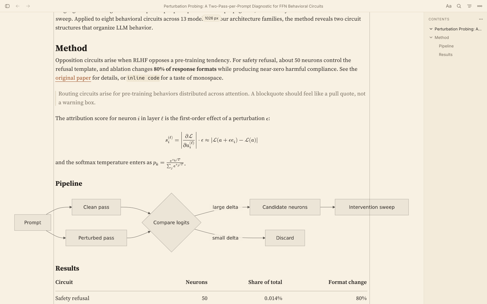 | 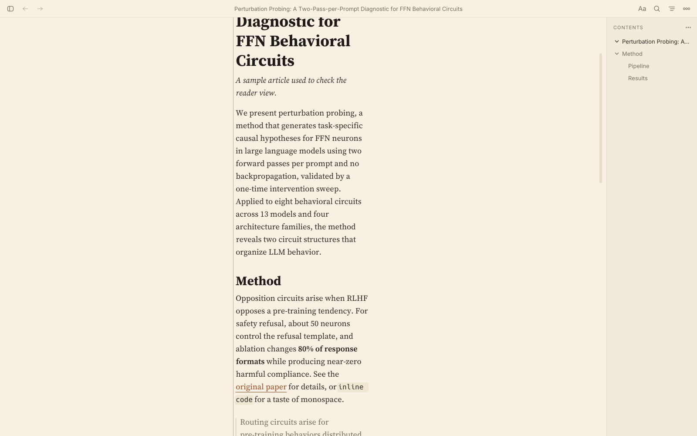 |

### One popover for how the page reads

The **Aa** button holds the theme swatches, the text size, a width slider
with **Fit window** and **Reset**, and three line spacings. Every control
acts as you touch it.

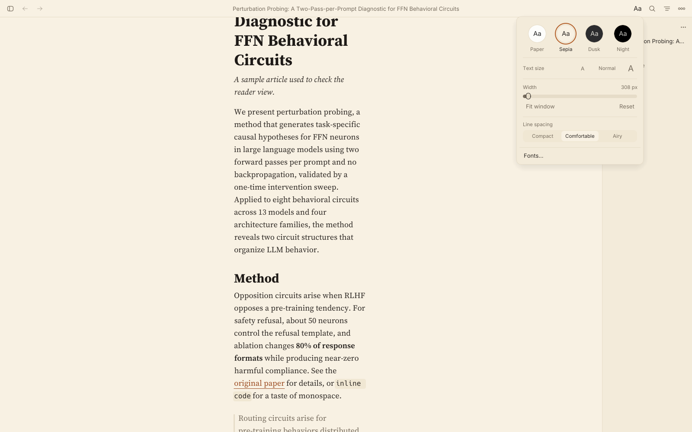

### Math, diagrams, tables and code

LaTeX formulas and Mermaid diagrams are drawn as ink on the page in the
theme's own colors, so they never sit in a white box. A diagram wider than
the column may use the room beside it. Tables have hairlines between rows
and honor the column alignment the Markdown asks for.

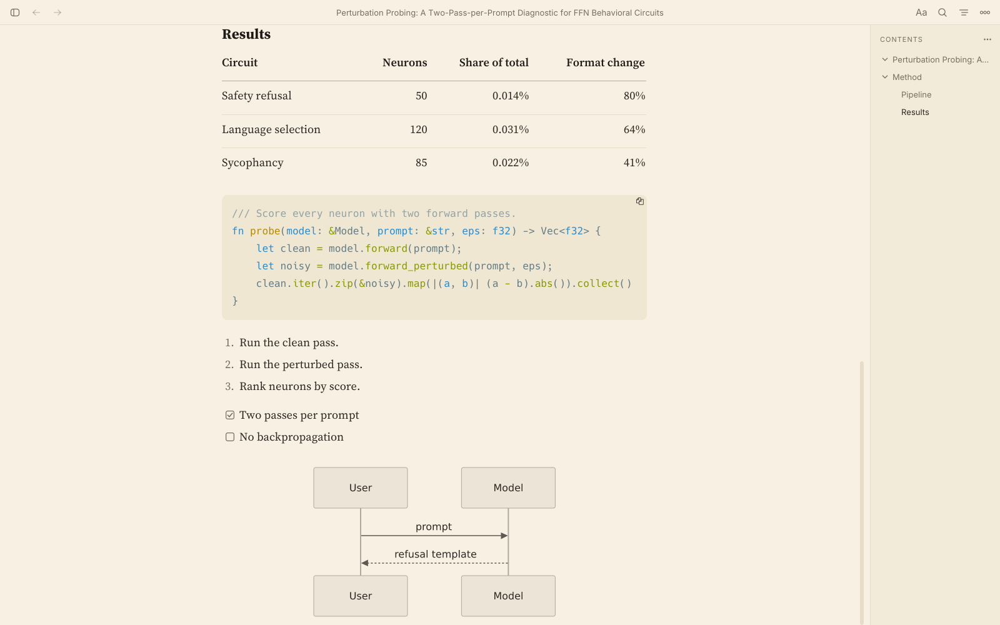

### Sidebars when you need them

A file list on the left and a table of contents on the right. The contents
list marks the heading you are reading. Both are hidden or shown with one
click and can be resized.

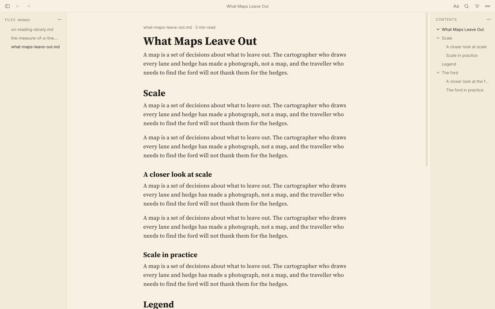

### A home page of what you read last

With no document open, md-viewer lists recent documents with their title,
folder, reading time and opening lines.

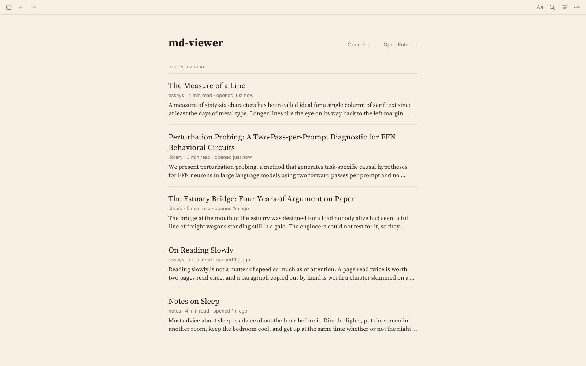

## Features

**Reading**

- Four themes, a resizable centered column, three line spacings, five text
  sizes and 50% to 300% zoom.
- Documents are set in the bundled
  [Source Serif 4](https://github.com/adobe-fonts/source-serif). Other font
  presets and any installed font family are under **Aa → Fonts…**.
- A `file-name · N min read` line above the title.

**Rendering**

- GitHub Flavored Markdown: tables, task lists, footnotes, strikethrough and
  emoji shortcodes such as `:pushpin:`. An emoji looks the same in bold
  text and headings as in the text around them.
- LaTeX math, inline `$…$` and display `$$…$$`.
- Mermaid diagrams: flowcharts, sequence, class, state, ER, gantt and pie.
  Click a diagram to enlarge it.
- Syntax highlighting for 200+ languages, with a color scheme per theme.
- Images (PNG, JPEG, GIF, SVG, local or over HTTP), HTML tables and YAML
  frontmatter.
- System font fallbacks for CJK and other non-Latin scripts.

**Getting around**

- Tabs, with back and forward history in each tab.
- Find in document (`Ctrl+F`) with highlighted matches.
- Links between Markdown files open in place; `Ctrl+Click` opens a new tab.
- Drag a file onto the window to open it.
- Live reload when the file changes on disk. **Live Reload** in **⋯** (`F5`)
  is checked while the setting is on, also with nothing open to follow.
- An edit mode (`Ctrl+E`) that shows the source and saves with `Ctrl+S`.
- The session is remembered: open tabs, theme, column width, sidebars.

## Install

This repository builds from source. You need a Rust toolchain; the version is
pinned in `rust-toolchain.toml` and `rustup` installs it on the first build.

```bash
git clone https://github.com/PhillipChaffee/md-viewer
```

```bash
cd md-viewer
```

```bash
cargo build --release
```

The binary is `target/release/md-viewer`. To copy it to `~/.local/bin`:

```bash
make install
```

### System packages

**Debian and Ubuntu**

```bash
sudo apt-get install -y clang pkg-config libxcb1-dev libxcb-render0-dev \
    libxcb-shape0-dev libxcb-xfixes0-dev libxkbcommon-dev libxkbcommon-x11-0 \
    libssl-dev libgtk-3-dev libfontconfig1-dev libdbus-1-dev
```

**Arch Linux**

```bash
sudo pacman -S --needed base-devel clang pkg-config libxcb libxkbcommon \
    openssl gtk3 fontconfig dbus zenity xdg-desktop-portal \
    xdg-desktop-portal-gtk python tk
```

**Open File** and **Open Folder** use the desktop's file chooser portal, and
fall back to a Tk dialog when there is none (`python3 -c 'import tkinter'`
tells you whether Tk is installed).

### Platforms

| Platform | State |
| --- | --- |
| Linux, X11 | Built and run for every change here |
| Linux, Wayland | Supported by the windowing backend; not exercised in this repository's checks |
| macOS, Windows | CI type-checks the code for both; the reader redesign has not been run on either |

### Packaged builds

md-viewer started as [aydiler/md-viewer](https://github.com/aydiler/md-viewer),
which publishes to crates.io, the Snap Store and the AUR. Those packages are
the upstream project. They do not include the reader redesign in this
repository, so build from source to get what the screenshots show.

## Usage

```bash
md-viewer notes.md
```

| Command | What it does |
| --- | --- |
| `md-viewer` | Opens the home page |
| `md-viewer file.md` | Opens the file and returns the terminal prompt |
| `md-viewer --foreground file.md` | Stays attached to the terminal, for logs |
| `md-viewer file.md --no-watch` | Opens without live reload |

## Keyboard shortcuts

| Shortcut | Action |
| --- | --- |
| `Ctrl+O` | Open a file |
| `Ctrl+W` | Close the tab |
| `Ctrl+Tab` / `Ctrl+Shift+Tab` | Next / previous tab |
| `Alt+←` / `Alt+→` | Back / forward |
| `Ctrl+F` | Find in document |
| `Ctrl+D` | Next theme |
| `Ctrl+Alt+←` / `Ctrl+Alt+→` | Narrow / widen the column |
| `Ctrl++` / `Ctrl+-` / `Ctrl+0` | Zoom in / out / reset |
| `Ctrl+Shift+E` | Files sidebar |
| `Ctrl+Shift+O` | Contents sidebar |
| `Ctrl+E` | Edit mode |
| `Ctrl+Q` | Quit |

## How it is built

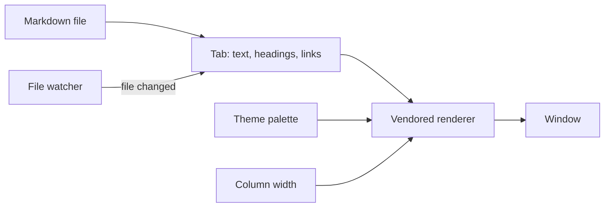

| Path | What lives there |
| --- | --- |
| `src/app/` | The window: top bar, popover, tabs, sidebars, home page, document pane |
| `src/theme/` | The four palettes. No other code names a color |
| `src/layout/` | The reading column and line spacing |
| `src/tab/`, `src/links/`, `src/headers/`, `src/search/` | One document: loading, link resolution, outline, find |
| `src/explorer/`, `src/watcher/` | The file tree and live reload |
| `src/system_fonts/` | Font discovery and the bundled faces |
| `vendor/egui_commonmark/` | A fork of [egui_commonmark](https://github.com/lampsitter/egui_commonmark) that does the Markdown layout, math and diagrams |
| `vendor/epaint/` | A patched copy of egui's painter |

## Development

The application crate runs under the Rust baseline from
[full-lint](https://github.com/PhillipChaffee/full-lint). One command runs
every check:

```bash
./run-gates.sh
```

| Gate | Rule |
| --- | --- |
| Lint | clippy `all`, `pedantic`, `nursery` and `cargo`, as errors |
| Docs | rustdoc's lints denied; every public item documented |
| Complexity | No function above cognitive complexity 15 |
| File length | No file above 1000 effective lines |
| Coverage | At least 95% of lines, regions and functions |
| Tests | No test shares a file with the code it tests |
| Dependencies | cargo-deny, osv-scanner and cargo-shear |
| Hygiene | Spelling, Markdown, links, secrets, duplication, shell and workflow lint |

The tests drive the real app without a window, clicking controls by their
accessible labels. To run them alone:

```bash
cargo test
```

A second layer of tests, in `tests/`, is written to survive a rewrite of
`src/`. It drives the whole app through one function and the built binary
through its command line and a real window on a virtual display, and it
asserts only what a user can observe. [tests/README.md](tests/README.md)
describes the layers, the rule its tests follow, and the extra packages the
window tests need.

Some of the arithmetic under the window is machine-checked as well: the
column width, zoom and scroll math, tab and search indices, history, and
the restore of saved settings. [PROOFS.md](PROOFS.md) lists every proof
with its bounds, and everything that is not proven. To run them (needs
[Kani](https://github.com/model-checking/kani)):

```bash
./run-proofs.sh
```

Two things to know before you rely on those gates:

- **The vendored renderer is outside them.** `vendor/egui_commonmark` has its
  own lint run and its own tests, but not the complexity, file-length or
  coverage gates. It holds a good share of the layout code.
- **Each exception is listed.** [GATES.md](GATES.md) names every ignored
  advisory, skipped duplicate and allowed lint, with the reason.

## Known limits

- Emoji are in color where Noto Color Emoji is installed, and in the ink of
  the text elsewhere. A sign that is an emoji only with a variation selector
  after it, such as ❤️, is in the ink of the text, and a joined sequence
  such as 👨‍👩‍👧 is drawn as its parts.
- Very large documents (tens of thousands of lines) scroll less smoothly.
- In edit mode the source is plain text with no highlighting.

## Credits

- [aydiler/md-viewer](https://github.com/aydiler/md-viewer), the project this
  one grew from.
- [egui and eframe](https://github.com/emilk/egui) for the GUI.
- [egui_commonmark](https://github.com/lampsitter/egui_commonmark) for the
  Markdown renderer this repository forks.
- [typst](https://github.com/typst/typst) and
  [mitex](https://github.com/mitex-rs/mitex) for math.
- [merman](https://github.com/Latias94/merman) for Mermaid diagrams.
- [syntect](https://github.com/trishume/syntect) for syntax highlighting.
- [Source Serif 4](https://github.com/adobe-fonts/source-serif) by Adobe,
  under the SIL Open Font License.

Third-party license texts are in `THIRD_PARTY_NOTICES`.

## License

MIT. See [LICENSE](LICENSE).
