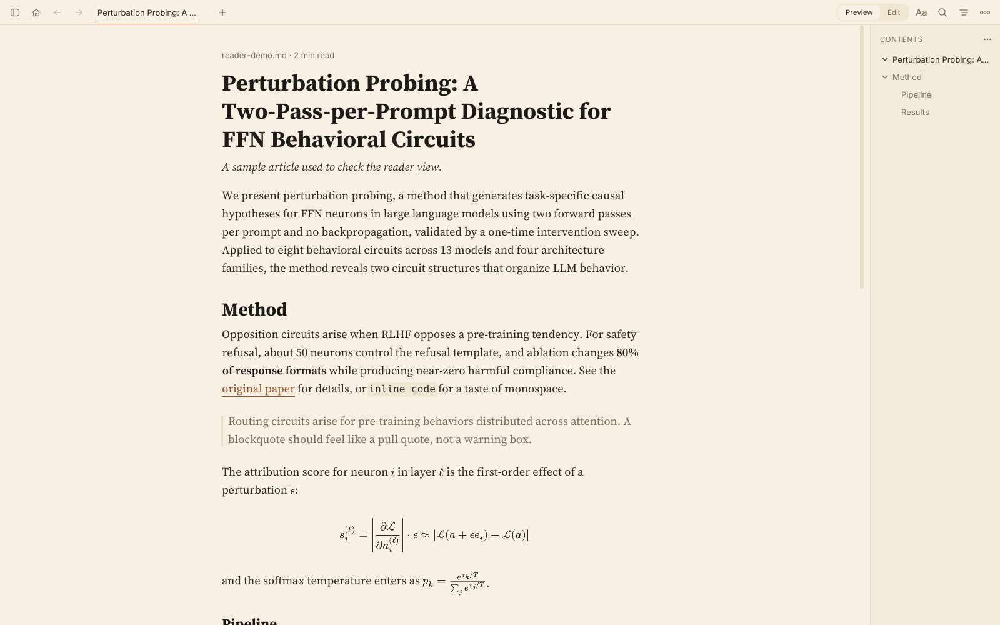
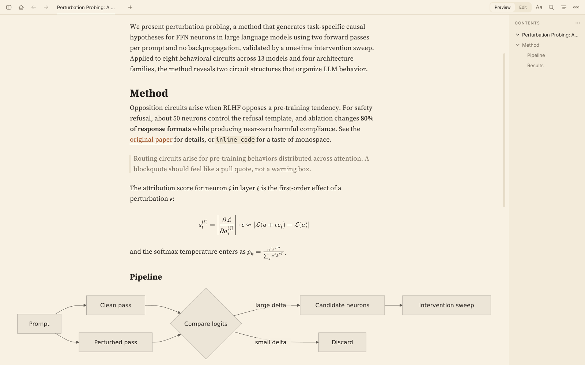
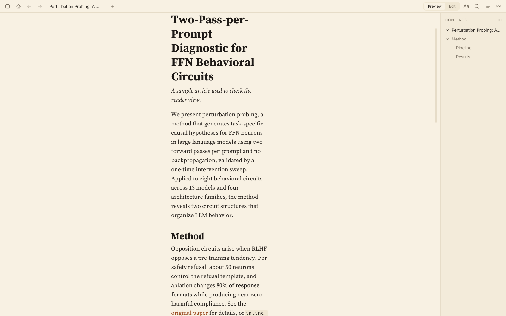
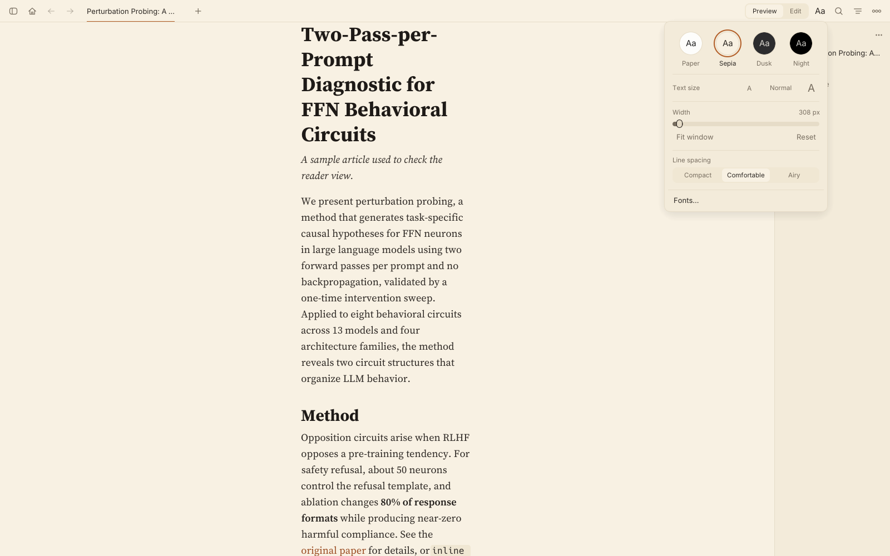
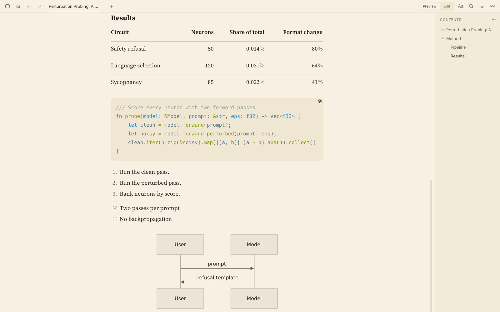
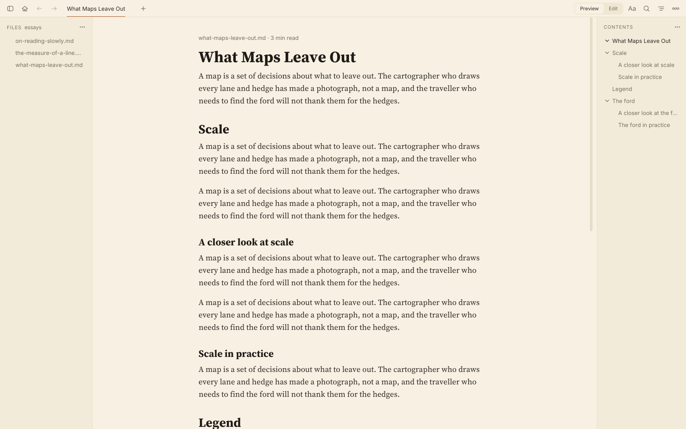
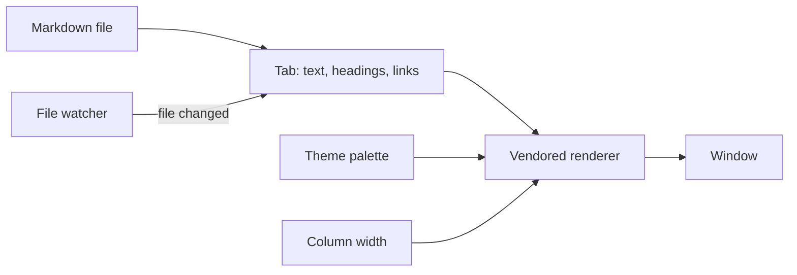

# md-viewer

A desktop reader for Markdown. It opens a `.md` file and shows it the way a
good read-later app shows an article: one sheet of paper, a centered column
of serif text, and nothing else on screen until you ask for it.

It is a native app written in Rust with [egui](https://github.com/emilk/egui).
It renders LaTeX math, Mermaid diagrams, tables and syntax-highlighted code,
and reloads the page when the file changes on disk.



## What it looks like

### Four themes

Paper, Sepia, Dusk and Night. Each one is a single palette that every part of
the window draws from, and body text keeps at least 7:1 contrast on all four.
Press `Ctrl+D` to step through them.

| Sepia | Paper |
| --- | --- |
|  |  |
| **Dusk** | **Night** |
|  |  |

### An icon that follows the theme

 

A serif M on a tile: dark on warm paper while Paper or Sepia is on, and
reversed on near-black while Dusk or Night is. The app opens with the one
that goes with the theme you used last, and a first run opens with the
sepia one.

| Where | What shows the icon |
| --- | --- |
| Mac | The Dock and the app switcher, while the app runs. It changes as soon as the theme crosses between light and dark, and the next launch opens with the one for the theme you left on. Finder shows a plain program icon for the binary itself; an icon there takes an `.app` bundle, which this repository does not build |
| Linux, X11 | The window, in the desktop's window list and task switcher. It changes as soon as the theme crosses between light and dark |
| Linux, Wayland | A Wayland window has no icon of its own. The desktop shows the launcher's, which `make install` puts in place and which is always the sepia one |

The two pictures are original work for this project, drawn as
`assets/icons/sepia.svg` and `assets/icons/reversed.svg`.

### A column as wide as you want

Drag either edge of the text and the column follows, from 280 px up to the
whole window. A small pill shows the width while you drag. Double-click an
edge to go back to the default.

| Dragging the edge out to 1026 px | Narrowed to about 300 px |
| --- | --- |
|  |  |

### One popover for how the page reads

The **Aa** button holds the theme swatches, the text size, a width slider
with **Fit window** and **Reset**, and three line spacings. Every control
acts as you touch it.



### Math, diagrams, tables and code

LaTeX formulas and Mermaid diagrams are drawn as ink on the page in the
theme's own colors, so they never sit in a white box. A diagram wider than
the column may use the room beside it. Tables have hairlines between rows
and honor the column alignment the Markdown asks for.



### Sidebars when you need them

A file list on the left and a table of contents on the right. The contents
list marks the heading you are reading. Both are hidden or shown with one
click and can be resized.

A click on a file shows it in the tab in front. To give it a tab of its
own, click the button that appears at the end of its row while you point
at it, `Ctrl`-click or middle-click the row, or pick **Open in New Tab**
from its right-click menu. A file that already has a tab comes to the
front instead. A dot after the name marks the files that have a tab.



### A home page of what you read last

The home page lists recent documents with their title, folder, reading
time and opening lines. It shows with no document open, and over the open
tabs when you press the Home button, **+**, `Ctrl+T` or **⋯ > New Tab**:
the tabs stay, and a document picked there opens in a new tab, or comes
to the front if it has one. The Home button again, Back, or a click on a
tab leads back.


## Features

**Reading**

- Four themes, a resizable centered column, three line spacings, five text
  sizes and 50% to 300% zoom.
- A menu taller than the window, as **⋯** is at a high zoom, scrolls:
  with the wheel, or with `Tab`, which brings each row into view.
- Documents are set in the bundled
  [Source Serif 4](https://github.com/adobe-fonts/source-serif), and their
  code in its companion,
  [Source Code Pro](https://github.com/adobe-fonts/source-code-pro). Other
  font presets and any installed font family are under **Aa → Fonts…**.
- Code in a line of prose has no box. It is a little smaller than the text
  around it and in a tint of its own, warm or on Sepia a muted olive,
  which keeps the same 7:1 contrast as body text on all four themes.
- A line ends only where prose can break. A bracket, a comma, a full stop
  or a letter written against a piece of code, a link or bold text stays
  on the line with it.
- A `file-name · N min read` line above the title.

**Rendering**

- GitHub Flavored Markdown: tables, task lists, footnotes, strikethrough and
  emoji shortcodes such as `:pushpin:`. An emoji looks the same in bold
  text and headings as in the text around them. An emoji written as
  several characters is one picture: a family (👨‍👩‍👧), a flag (🇯🇵), a skin
  tone (👍🏽), a keycap (1️⃣, #️⃣, \*️⃣). A variation selector picks the look of the
  sign before it: ❤️ is the color emoji and ❤︎ the sign in the ink of the
  text.
- LaTeX math, inline `$…$` and display `$$…$$`.
- Mermaid diagrams: flowcharts, sequence, class, state, ER, gantt and pie.
  Click a diagram to enlarge it.
- Syntax highlighting for 200+ languages, with a color scheme per theme.
- Images (PNG, JPEG, GIF, WebP, SVG, local or over HTTP), HTML tables and
  YAML frontmatter. A picture is read only once you are near it, so a
  long page of pictures opens at once. Animated GIFs and WebPs play while
  they are in view.
  Click a picture to enlarge it; a moving one goes on playing while it is
  enlarged.
- System font fallbacks for CJK and other non-Latin scripts.

**Getting around**

- Tabs in the top row, each named by its document's first heading, with
  back and forward history in each tab. The row is the same with one
  document or many, and tabs that do not fit scroll inside it.
- Tabs whose documents share a name show their folders too, as
  `Notes · guides` and `Notes · drafts`, with the folder above where
  the folders share a name as well (`Notes · a/guides`). A name too long
  for its tab is cut short before the folder, and a long folder is drawn
  without what it shares with the other one (`Notes · …-board-1998`). The window's title and the
  questions about unsaved edits and about overwriting a changed file name
  a file with its folder in the same way while two open files share a
  name.
- On a Mac that row is the window's title bar: the close, minimize and
  zoom buttons sit in it, on its centre line, and the row starts after
  them. Drag an empty part of the row to move the window; double-click
  one to zoom it. In full screen, where macOS hides the three buttons,
  the row starts at the window's edge. Linux and Windows keep the title
  bar their desktop draws.
- Find in document (`Ctrl+F`) with highlighted matches.
- Links between Markdown files open in place; `Ctrl+Click` opens a new tab.
- A file in the sidebar opens in place too; its row's button, `Ctrl+Click`,
  a middle click or **Open in New Tab** in its menu opens a new tab.
- Drag a file onto the window to open it.
- Live reload when the file changes on disk. **Live Reload** in **⋯** (`F5`)
  is checked while the setting is on, also with nothing open to follow.
- An edit mode (`Ctrl+E`) that shows the source and saves with `Ctrl+S`.
  An emoji drawn as one picture is one character to the arrow keys,
  Backspace and Delete.
- Closing a tab that has unsaved edits asks first: **Save**, **Discard**
  or **Cancel** (also `Esc`). **Close Others** and quitting ask about each
  unsaved document in turn and close nothing until the last answer, so
  **Cancel** at any question leaves every tab open with its edits. A
  link, a file in the sidebar, Back or Forward asks the same before it
  shows another document in a tab with unsaved edits.
  On a Mac quitting covers `⌘Q`, **⋯ > Quit**, the window's close
  button, and **Quit** in the menu bar and in the Dock. Logging out with
  unsaved edits asks too, and the log-out stops there, as it does for any
  Mac app that has a question: log out again once the app has closed.
- A file that another program changes while its document has unsaved
  edits is neither reloaded nor overwritten. A bar on the document says
  the file changed on disk, with **Reload** (take the file, drop the
  edits) and **Keep mine**. A save then asks before it replaces what the
  other program wrote: **Overwrite** or **Cancel**. With live reload off
  the question still comes at the save.
- The session is remembered: open tabs, theme, column width, sidebars.

## Install

This repository builds from source. You need a Rust toolchain; the version is
pinned in `rust-toolchain.toml` and `rustup` installs it on the first build.

```bash
git clone https://github.com/PhillipChaffee/md-viewer
```

```bash
cd md-viewer
```

```bash
cargo build --release
```

The binary is `target/release/md-viewer`. To copy it to `~/.local/bin`:

```bash
make install
```

On Linux that also installs a launcher for the desktop's menu and, under
`~/.local/share/icons`, the icon the launcher shows. `make uninstall`
removes all of it.

### System packages

**Debian and Ubuntu**

```bash
sudo apt-get install -y clang pkg-config libxcb1-dev libxcb-render0-dev \
    libxcb-shape0-dev libxcb-xfixes0-dev libxkbcommon-dev libxkbcommon-x11-0 \
    libssl-dev libgtk-3-dev libfontconfig1-dev libdbus-1-dev
```

**Arch Linux**

```bash
sudo pacman -S --needed base-devel clang pkg-config libxcb libxkbcommon \
    openssl gtk3 fontconfig dbus zenity xdg-desktop-portal \
    xdg-desktop-portal-gtk python tk
```

**Open File** and **Open Folder** use the desktop's file chooser portal, and
fall back to a Tk dialog when there is none (`python3 -c 'import tkinter'`
tells you whether Tk is installed).

### Platforms

| Platform | State |
| --- | --- |
| Linux, X11 | Built and run for every change here |
| Linux, Wayland | Supported by the windowing backend; not exercised in this repository's checks |
| macOS, Windows | CI type-checks the code for both; the reader redesign has not been run on either. That includes everything Mac-only: the window's buttons in the top row, `⌘Q` reaching the app and the icon in the Dock have never been seen on a Mac |

### Packaged builds

md-viewer started as [aydiler/md-viewer](https://github.com/aydiler/md-viewer),
which publishes to crates.io, the Snap Store and the AUR. Those packages are
the upstream project. They do not include the reader redesign in this
repository, so build from source to get what the screenshots show.

## Usage

```bash
md-viewer notes.md
```

| Command | What it does |
| --- | --- |
| `md-viewer` | Opens the home page |
| `md-viewer file.md` | Opens the file and returns the terminal prompt |
| `md-viewer --foreground file.md` | Stays attached to the terminal, for logs |
| `md-viewer file.md --no-watch` | Opens without live reload |

## Keyboard shortcuts

| Linux and Windows | Mac | Action |
| --- | --- | --- |
| `Ctrl+O` | `⌘O` | Open a file |
| `Ctrl+T` | `⌘T` | New tab: shows the home page |
| `Ctrl+Shift+H` | `⇧⌘H` | Home page, and back to the document |
| `Ctrl+W` | `⌘W` | Close the tab |
| `Ctrl+Tab` / `Ctrl+Shift+Tab` | `⌃Tab` / `⌃⇧Tab` | Next / previous tab |
| `Ctrl+1` to `Ctrl+9` | `⌘1` to `⌘9` | Go to a tab by its place |
| `Alt+←` / `Alt+→` | `⌘[` / `⌘]` | Back / forward |
| `Ctrl+F` | `⌘F` | Find in document |
| `Ctrl+D` | `⌘D` | Next theme |
| `Ctrl+Alt+←` / `Ctrl+Alt+→` | `⌥⌘←` / `⌥⌘→` | Narrow / widen the column |
| `Ctrl++` / `Ctrl+-` / `Ctrl+0` | `⌘+` / `⌘-` / `⌘0` | Zoom in / out / reset |
| `Ctrl+Shift+E` | `⇧⌘E` | Files sidebar |
| `Ctrl+Shift+O` | `⇧⌘O` | Contents sidebar |
| `Ctrl+E` | `⌘E` | Edit mode |
| `Ctrl+S` | `⌘S` | Save the edits |
| `F5` | `F5` | Live reload on or off |
| `Ctrl+Q` | `⌘Q` | Quit |

With the mouse:

| Linux and Windows | Mac | Action |
| --- | --- | --- |
| Click a file in the sidebar | the same | Show it in the tab in front |
| `Ctrl`-click a file or a link | ⌘-click | Open it in a new tab |
| Middle-click a file in the sidebar | the same | Open it in a new tab |
| Right-click a file in the sidebar | the same | **Open**, **Open in New Tab**, and what to copy |
| Middle-click a tab | the same | Close the tab |

On a Mac the command key is ⌘, and wherever this file says `Ctrl` read ⌘
there: `⌘D`, `⌘F`, ⌘-click on a link. The one exception is the tab switch,
which is the Control key on a Mac too, because ⌘ with Tab switches apps.
The menus and tooltips show the Mac's own signs. Control with a letter and
Option with an arrow are left to the text you are editing.

Without the mouse: `Tab` and `Shift+Tab` step through the buttons, the tabs,
the rows of the sidebars and the documents of the home page, and a ring in
the theme's accent shows which one the keyboard is on. `Enter` or `Space` presses it. Each tab's close
button comes right after its tab, so `Enter` there closes that tab, and
asks first when it has unsaved edits.

## How it is built



| Path | What lives there |
| --- | --- |
| `src/app/` | The window: top bar, popover, tabs, sidebars, home page, document pane |
| `src/theme/` | The four palettes. No other code names a color |
| `src/app_icon/`, `assets/icons/` | The two forms of the app's icon, and which one goes with a theme |
| `src/layout/` | The reading column and line spacing |
| `src/tab/`, `src/links/`, `src/headers/`, `src/search/` | One document: loading, link resolution, outline, find |
| `src/explorer/`, `src/watcher/` | The file tree and live reload |
| `src/system_fonts/` | Font discovery and the bundled faces |
| `vendor/egui_commonmark/` | A fork of [egui_commonmark](https://github.com/lampsitter/egui_commonmark) that does the Markdown layout, math and diagrams |
| `vendor/epaint/` | A patched copy of egui's painter |
| `crates/mac-window/` | What the window asks of macOS: the window's buttons on the top row's centre line, `⌘Q` handed to the app, the app asked before macOS quits it, and the Dock's icon set to the theme's. Does nothing elsewhere. Holds the three unsafe functions ([GATES.md](GATES.md)) |

## Development

The application crate runs under the Rust baseline from
[full-lint](https://github.com/PhillipChaffee/full-lint), at the commit CI
pins. One command runs every check, after one that installs the pinned
tools:

```bash
./gates tools
./gates
```

| Gate | Rule |
| --- | --- |
| Lint | clippy `all`, `pedantic`, `nursery` and `cargo`, as errors |
| Docs | rustdoc's lints denied; every public item documented |
| Complexity | No function above cognitive complexity 15 |
| File length | No file above 1000 effective lines |
| Coverage | At least 95% of lines, regions and functions |
| Tests | No test shares a file with the code it tests |
| Dependencies | cargo-deny, osv-scanner and cargo-shear |
| Hygiene | Spelling, Markdown, links, secrets, duplication, shell and workflow lint |

The tests drive the real app without a window, clicking controls by their
accessible labels. To run them alone:

```bash
cargo test
```

A second layer of tests, in `tests/`, is written to survive a rewrite of
`src/`. It drives the whole app through one function and the built binary
through its command line and a real window on a virtual display, and it
asserts only what a user can observe. [tests/README.md](tests/README.md)
describes the layers, the rule its tests follow, and the extra packages the
window tests need.

Some of the arithmetic under the window is machine-checked as well: the
column width, zoom and scroll math, tab and search indices, history, and
the restore of saved settings. [PROOFS.md](PROOFS.md) lists every proof
with its bounds, and everything that is not proven. To run them (needs
[Kani](https://github.com/model-checking/kani)):

```bash
./run-proofs.sh
```

Two things to know before you rely on those gates:

- **The vendored renderer is outside them.** `vendor/egui_commonmark` has its
  own lint run and its own tests, but not the complexity, file-length or
  coverage gates. It holds a good share of the layout code.
- **Each exception is listed.** [GATES.md](GATES.md) names every ignored
  advisory, skipped duplicate and allowed lint, with the reason.

## Mutation testing

Mutation testing checks the tests themselves.
[cargo-mutants](https://mutants.rs/) changes the code one small step at a
time: a `-` becomes a `+`, a comparison flips, a function returns a default.
It then runs the tests against each change, which is called a mutant. A
mutant that makes a test fail is caught. A mutant that every test passes
is missed, and it marks code whose behavior no test pins down.

### What runs, and when

The `mutation` workflow (`.github/workflows/mutation.yml`) runs every night
at 04:23 UTC, and GitHub has started it up to nine hours late. To run it by
hand, open **Actions > mutation > Run workflow** and pick `main`. It never
runs on a pull request, because one run builds and tests the app once per
mutant.

| What | Which |
| --- | --- |
| Tool | cargo-mutants 27.1.0, the prebuilt release, checked against its sha256 in the workflow |
| Mutated | All of `src/` and `crates/mac-window/src/lib.rs`: 2282 mutants |
| Not mutated | `src/**/proofs.rs`, which only `cargo kani` compiles; `crates/mac-window/src/mac.rs`, which only a Mac compiles; `vendor/`, which is outside the workspace |
| Tests run against each mutant | The unit tests of both crates and `tests/reader` |
| Tests not run against each mutant | `tests/e2e`. Its window tests need a virtual display and run on every pull request in the `full-lint-code` job |
| Shards | 48 runners, each with `--shard k/48`. Mutant `i` goes to shard `i % 48`, so each shard gets part of every file |
| Result | A last job named `mutation` merges the shards and applies the floor |

The settings are in `.cargo/mutants.toml`, with a reason beside each one.
A local run reads the same file.

### The floor

The score is the share of tested mutants that the tests catch. A mutant
that does not compile is unviable: no test runs against it, so it is left
out. A mutant that runs past its time limit counts as missed. The run
fails when the score is below 85%.

The floor is not 100% because some mutants are equivalent: the change
alters nothing a test can see. For example, a boundary comparison inside
a clamp returns the same bound either way. No test can catch such a
mutant, so a floor of 100% would fail forever. 85% leaves room for those
and still fails when a module's tests stop checking its results.

The run also fails when any shard stops with an error, for example when
the tests fail on the unchanged code. Then no score is given.

### Run it for one file

Install the same version, then name the file:

```bash
cargo install --locked cargo-mutants@27.1.0
cargo mutants -f src/search/mod.rs
```

Add `--workspace` for a file in `crates/mac-window`. `cargo mutants --list`
lists the mutants without running them. The first build and the baseline
take several minutes. After that, each mutant takes from 5 seconds (it does
not compile) to about 3 minutes (only `tests/reader` can catch it, or
nothing does).

### Read the results

A local run writes `mutants.out/`:

| File | What it holds |
| --- | --- |
| `missed.txt` | One line per missed mutant: file, line, column and the change, for example `src/layout/mod.rs:213:56: replace - with / in zoomed` |
| `timeout.txt` | Mutants that ran past the time limit |
| `caught.txt`, `unviable.txt` | The other two outcomes |
| `diff/` | The exact change of each mutant |
| `log/` | The build and test output of each mutant |
| `outcomes.json` | The counts that the score is made from |

In the workflow, the `mutation` job's log prints the score and every missed
mutant. Each shard uploads its `mutants.out/` as the artifact
`mutants-shard-k`, kept for 14 days. For a missed mutant, write a test that
fails with the change applied and passes without it. If no test can tell
the difference, the mutant is equivalent. Leave it, and the floor absorbs
it.

## Website

The project's page is a static site in [`docs/`](docs/): one page, a page
for a wrong address, three font files and ten screenshots, each at up to
three sizes of window. Nothing builds
it. GitHub Pages serves the folder as it is from `main`, at
`https://phillipchaffee.github.io/md-viewer/`, once **Settings > Pages** is
set to deploy from the `main` branch and its `/docs` folder. A merge to
`main` that changes `docs/` republishes it.

To see it on your own machine:

```bash
python3 -m http.server -d docs
```

Then open `http://localhost:8000`.

Three things in `docs/` are written by hand to follow the rest of the
repository:

- The version in the page's top strip, and the shortcuts, the contrast
  and the theme colors it quotes, are written out. Each carries a
  `data-fact` attribute, and `scripts/check-site-facts.sh`, a step of CI,
  reads the same fact from `Cargo.toml`, `src/` and this file and fails
  where the page disagrees. A fact added to the page needs the attribute
  and a line in the script.
- The screenshots in `docs/img/` were taken for the page, of the app in
  windows of three sizes on a screen of twice the usual density, and the
  page's width picks the size. Above 900 px it is 1280 by 800: a lossless
  WebP 2560 px wide, and a copy 1280 px wide for screens that need no
  more. Up to 900 px the seven views are 960 by 600 (`-mid-` in the
  name), and up to 600 px all ten are 480 by 720 (`-narrow-`), which the
  seven views have at three times the density as well. The number that
  ends a name is the picture's width. The narrow window has room for one
  sidebar and two short tab names, so its tabs are two samples with
  one-word headings, and its flowchart runs from top to bottom. They are
  not the ones in `screenshots/reader/`, and a change to how the app
  looks does not reach them. The social card, `docs/og.png`, is a picture
  of the top of the page.
- The social card tags in `docs/index.html` hold the site's whole address,
  which a card needs. Every link to the site's own files is relative, so
  the page works under any address.

## Known limits

- Emoji are in color where Noto Color Emoji is installed, and in the ink of
  the text elsewhere. An emoji written as several characters is drawn as
  its parts where no installed emoji font has one picture for it, as with
  an emoji newer than the font. In edit mode the arrow keys, Backspace and
  Delete then go through it part by part, as it is drawn.
- A `*` that Markdown reads as the start or the end of emphasis is not part
  of a keycap: `a*️⃣b*️⃣c` sets the `b` in italics. Write `\*️⃣` there.
- While the find bar marks part of an emoji written as several characters,
  such as the `1` of 1️⃣, that emoji is drawn as its parts.
- In a table cell a line can still end between a piece of code, a link or
  bold text and the bracket or comma written against it. Anywhere, it can
  end between a formula, a picture or a footnote mark in a line of prose
  and what is written against that.
- A picture is read when you come within a window's height of it, and
  decoded in the background. Until it is there its place is empty, with a
  spinner while it is in view. An animated GIF or WebP is decoded whole:
  120 frames of 800 × 600 take about a second in a release build, and
  each frame takes four bytes of memory for each of its pixels.
- The size of a picture on the web, and of an SVG, is not known until it
  has been read. Its place is a small one until then, and the text after it
  moves down when it arrives. What you are reading stays where it is if the
  picture is above it, unless the page shows that picture more than once.
- A moving picture whose frames need more than 256 MiB (139 frames of
  800 × 600) shows its first frame and does not move. When the frames of
  all moving pictures pass 512 MiB, those more than a window's height from
  the view are let go, and decoded again when you come back to them. A
  picture that is being decoded counts as 256 MiB until it is there, so
  others can be let go before 512 MiB are in use.
- A picture that does not move stays in memory, once read, until its tab
  is closed.
- Very large documents (tens of thousands of lines) scroll less smoothly.
- In edit mode the source is plain text with no highlighting.

## Credits

- [aydiler/md-viewer](https://github.com/aydiler/md-viewer), the project this
  one grew from.
- [egui and eframe](https://github.com/emilk/egui) for the GUI.
- [egui_commonmark](https://github.com/lampsitter/egui_commonmark) for the
  Markdown renderer this repository forks.
- [typst](https://github.com/typst/typst) and
  [mitex](https://github.com/mitex-rs/mitex) for math.
- [merman](https://github.com/Latias94/merman) for Mermaid diagrams.
- [syntect](https://github.com/trishume/syntect) for syntax highlighting.
- [Source Serif 4](https://github.com/adobe-fonts/source-serif) and
  [Source Code Pro](https://github.com/adobe-fonts/source-code-pro) by
  Adobe, under the SIL Open Font License.

Third-party license texts are in `THIRD_PARTY_NOTICES`.

## License

MIT. See [LICENSE](LICENSE).
