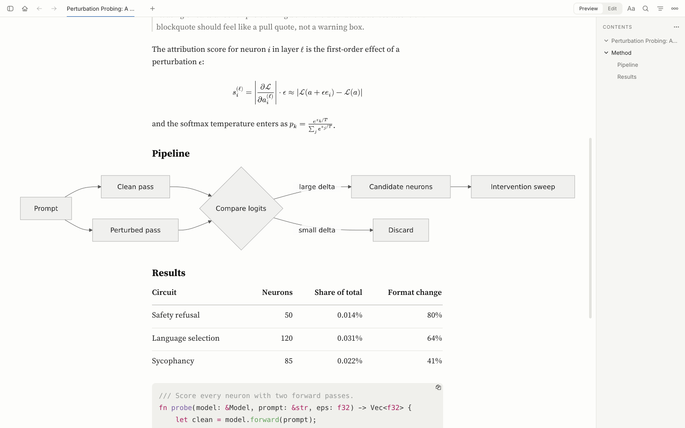
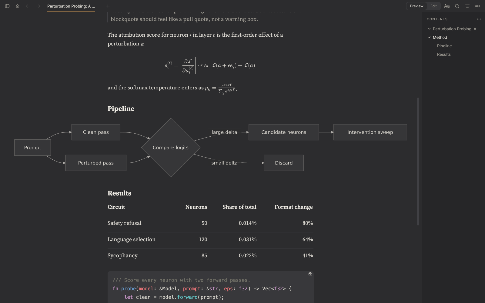
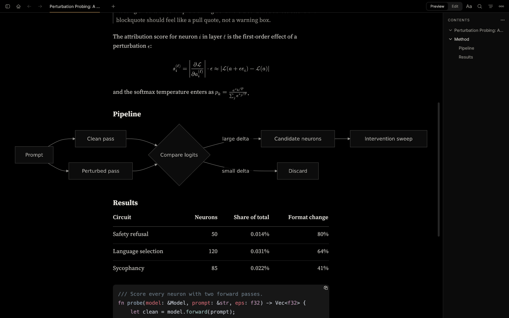
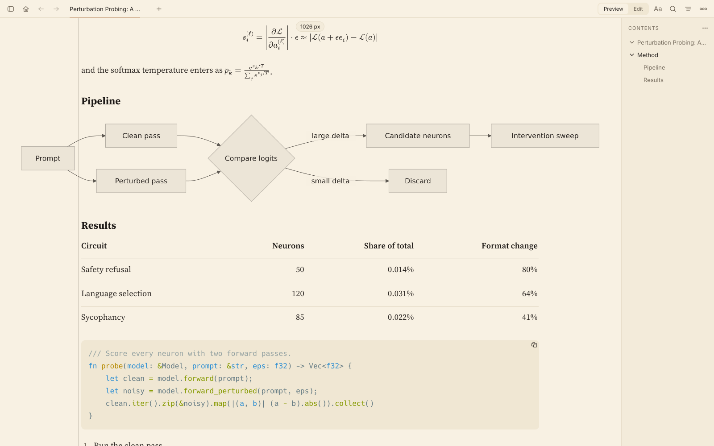
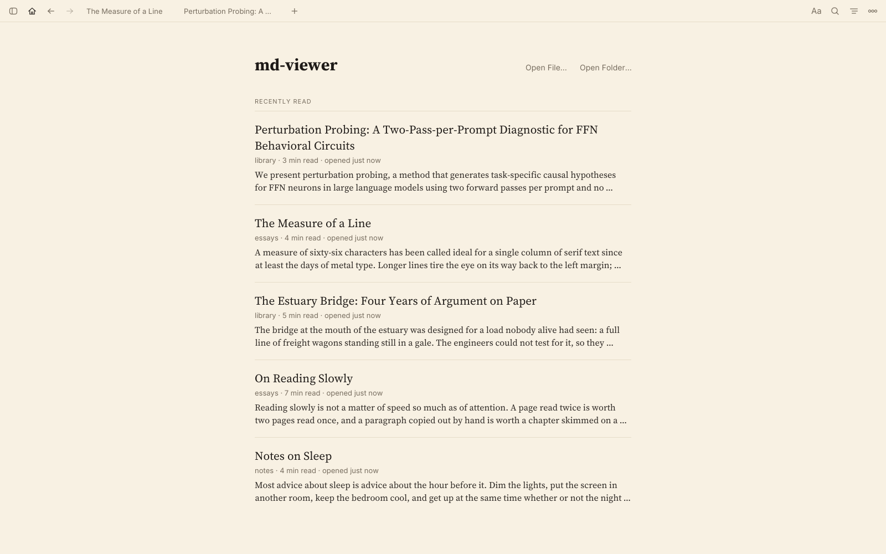
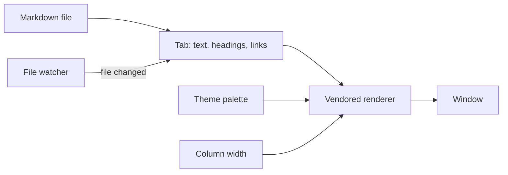

# md-viewer

A desktop reader for Markdown. It opens a `.md` file and shows it the way a
good read-later app shows an article: one sheet of paper, a centered column
of serif text, and nothing else on screen until you ask for it.

It is a native app written in Rust with [egui](https://github.com/emilk/egui).
It renders LaTeX math, Mermaid diagrams, tables and syntax-highlighted code,
and reloads the page when the file changes on disk.


## What it looks like

### Four themes

Paper, Sepia, Dusk and Night. Each one is a single palette that every part of
the window draws from, and body text keeps at least 7:1 contrast on all four.
Press `Ctrl+D` to step through them.

| Sepia | Paper |
| --- | --- |
|  |  |
| **Dusk** | **Night** |
|  |  |

### A column as wide as you want

Drag either edge of the text and the column follows, from 280 px up to the
whole window. A small pill shows the width while you drag. Double-click an
edge to go back to the default.

| Dragging the edge out to 1026 px | Narrowed to about 300 px |
| --- | --- |
|  |  |

### One popover for how the page reads

The **Aa** button holds the theme swatches, the text size, a width slider
with **Fit window** and **Reset**, and three line spacings. Every control
acts as you touch it.


### Math, diagrams, tables and code

LaTeX formulas and Mermaid diagrams are drawn as ink on the page in the
theme's own colors, so they never sit in a white box. A diagram wider than
the column may use the room beside it. Tables have hairlines between rows
and honor the column alignment the Markdown asks for.


### Sidebars when you need them

A file list on the left and a table of contents on the right. The contents
list marks the heading you are reading. Both are hidden or shown with one
click and can be resized.

A click on a file shows it in the tab in front. To give it a tab of its
own, click the button that appears at the end of its row while you point
at it, `Ctrl`-click or middle-click the row, or pick **Open in New Tab**
from its right-click menu. A file that already has a tab comes to the
front instead. A dot after the name marks the files that have a tab.


### A home page of what you read last

The home page lists recent documents with their title, folder, reading
time and opening lines. It shows with no document open, and over the open
tabs when you press the Home button, **+** or `Ctrl+T`: the tabs stay, and
a document picked there opens in a new tab, or comes to the front if it
has one. The Home button again, Back, or a click on a tab leads back.



## Features

**Reading**

- Four themes, a resizable centered column, three line spacings, five text
  sizes and 50% to 300% zoom.
- Documents are set in the bundled
  [Source Serif 4](https://github.com/adobe-fonts/source-serif). Other font
  presets and any installed font family are under **Aa → Fonts…**.
- A `file-name · N min read` line above the title.

**Rendering**

- GitHub Flavored Markdown: tables, task lists, footnotes, strikethrough and
  emoji shortcodes such as `:pushpin:`. An emoji looks the same in bold
  text and headings as in the text around them. An emoji written as
  several characters is one picture: a family (👨‍👩‍👧), a flag (🇯🇵), a skin
  tone (👍🏽), a keycap (1️⃣, #️⃣, \*️⃣). A variation selector picks the look of the
  sign before it: ❤️ is the color emoji and ❤︎ the sign in the ink of the
  text.
- LaTeX math, inline `$…$` and display `$$…$$`.
- Mermaid diagrams: flowcharts, sequence, class, state, ER, gantt and pie.
  Click a diagram to enlarge it.
- Syntax highlighting for 200+ languages, with a color scheme per theme.
- Images (PNG, JPEG, GIF, WebP, SVG, local or over HTTP), HTML tables and
  YAML frontmatter. A picture is read only once you are near it, so a
  long page of pictures opens at once. Animated GIFs and WebPs play while
  they are in view.
  Click a picture to enlarge it; a moving one goes on playing while it is
  enlarged.
- System font fallbacks for CJK and other non-Latin scripts.

**Getting around**

- Tabs in the top row, each named by its document's first heading, with
  back and forward history in each tab. The row is the same with one
  document or many, and tabs that do not fit scroll inside it.
- On a Mac that row is the window's title bar: the close, minimize and
  zoom buttons sit in it, on its centre line, and the row starts after
  them. Drag an empty part of the row to move the window; double-click
  one to zoom it. In full screen, where macOS hides the three buttons,
  the row starts at the window's edge. Linux and Windows keep the title
  bar their desktop draws.
- Find in document (`Ctrl+F`) with highlighted matches.
- Links between Markdown files open in place; `Ctrl+Click` opens a new tab.
- A file in the sidebar opens in place too; its row's button, `Ctrl+Click`,
  a middle click or **Open in New Tab** in its menu opens a new tab.
- Drag a file onto the window to open it.
- Live reload when the file changes on disk. **Live Reload** in **⋯** (`F5`)
  is checked while the setting is on, also with nothing open to follow.
- An edit mode (`Ctrl+E`) that shows the source and saves with `Ctrl+S`.
  An emoji drawn as one picture is one character to the arrow keys,
  Backspace and Delete.
- Closing a tab that has unsaved edits asks first: **Save**, **Discard**
  or **Cancel** (also `Esc`). **Close Others** and quitting ask about each
  unsaved document in turn and close nothing until the last answer, so
  **Cancel** at any question leaves every tab open with its edits. A
  link, a file in the sidebar, Back or Forward asks the same before it
  shows another document in a tab with unsaved edits.
  On a Mac quitting covers `⌘Q`, **⋯ > Quit** and the window's close
  button. **Quit** picked with the mouse from the menu bar or from the
  Dock is macOS's own and still quits without asking.
- The session is remembered: open tabs, theme, column width, sidebars.

## Install

This repository builds from source. You need a Rust toolchain; the version is
pinned in `rust-toolchain.toml` and `rustup` installs it on the first build.

```bash
git clone https://github.com/PhillipChaffee/md-viewer
```

```bash
cd md-viewer
```

```bash
cargo build --release
```

The binary is `target/release/md-viewer`. To copy it to `~/.local/bin`:

```bash
make install
```

### System packages

**Debian and Ubuntu**

```bash
sudo apt-get install -y clang pkg-config libxcb1-dev libxcb-render0-dev \
    libxcb-shape0-dev libxcb-xfixes0-dev libxkbcommon-dev libxkbcommon-x11-0 \
    libssl-dev libgtk-3-dev libfontconfig1-dev libdbus-1-dev
```

**Arch Linux**

```bash
sudo pacman -S --needed base-devel clang pkg-config libxcb libxkbcommon \
    openssl gtk3 fontconfig dbus zenity xdg-desktop-portal \
    xdg-desktop-portal-gtk python tk
```

**Open File** and **Open Folder** use the desktop's file chooser portal, and
fall back to a Tk dialog when there is none (`python3 -c 'import tkinter'`
tells you whether Tk is installed).

### Platforms

| Platform | State |
| --- | --- |
| Linux, X11 | Built and run for every change here |
| Linux, Wayland | Supported by the windowing backend; not exercised in this repository's checks |
| macOS, Windows | CI type-checks the code for both; the reader redesign has not been run on either. That includes everything Mac-only: the window's buttons in the top row and `⌘Q` reaching the app have never been seen on a Mac |

### Packaged builds

md-viewer started as [aydiler/md-viewer](https://github.com/aydiler/md-viewer),
which publishes to crates.io, the Snap Store and the AUR. Those packages are
the upstream project. They do not include the reader redesign in this
repository, so build from source to get what the screenshots show.

## Usage

```bash
md-viewer notes.md
```

| Command | What it does |
| --- | --- |
| `md-viewer` | Opens the home page |
| `md-viewer file.md` | Opens the file and returns the terminal prompt |
| `md-viewer --foreground file.md` | Stays attached to the terminal, for logs |
| `md-viewer file.md --no-watch` | Opens without live reload |

## Keyboard shortcuts

| Linux and Windows | Mac | Action |
| --- | --- | --- |
| `Ctrl+O` | `⌘O` | Open a file |
| `Ctrl+T` | `⌘T` | New tab: shows the home page |
| `Ctrl+Shift+H` | `⇧⌘H` | Home page, and back to the document |
| `Ctrl+W` | `⌘W` | Close the tab |
| `Ctrl+Tab` / `Ctrl+Shift+Tab` | `⌃Tab` / `⌃⇧Tab` | Next / previous tab |
| `Ctrl+1` to `Ctrl+9` | `⌘1` to `⌘9` | Go to a tab by its place |
| `Alt+←` / `Alt+→` | `⌘[` / `⌘]` | Back / forward |
| `Ctrl+F` | `⌘F` | Find in document |
| `Ctrl+D` | `⌘D` | Next theme |
| `Ctrl+Alt+←` / `Ctrl+Alt+→` | `⌥⌘←` / `⌥⌘→` | Narrow / widen the column |
| `Ctrl++` / `Ctrl+-` / `Ctrl+0` | `⌘+` / `⌘-` / `⌘0` | Zoom in / out / reset |
| `Ctrl+Shift+E` | `⇧⌘E` | Files sidebar |
| `Ctrl+Shift+O` | `⇧⌘O` | Contents sidebar |
| `Ctrl+E` | `⌘E` | Edit mode |
| `Ctrl+S` | `⌘S` | Save the edits |
| `F5` | `F5` | Live reload on or off |
| `Ctrl+Q` | `⌘Q` | Quit |

With the mouse:

| Linux and Windows | Mac | Action |
| --- | --- | --- |
| Click a file in the sidebar | the same | Show it in the tab in front |
| `Ctrl`-click a file or a link | ⌘-click | Open it in a new tab |
| Middle-click a file in the sidebar | the same | Open it in a new tab |
| Right-click a file in the sidebar | the same | **Open**, **Open in New Tab**, and what to copy |
| Middle-click a tab | the same | Close the tab |

On a Mac the command key is ⌘, and wherever this file says `Ctrl` read ⌘
there: `⌘D`, `⌘F`, ⌘-click on a link. The one exception is the tab switch,
which is the Control key on a Mac too, because ⌘ with Tab switches apps.
The menus and tooltips show the Mac's own signs. Control with a letter and
Option with an arrow are left to the text you are editing.

## How it is built



| Path | What lives there |
| --- | --- |
| `src/app/` | The window: top bar, popover, tabs, sidebars, home page, document pane |
| `src/theme/` | The four palettes. No other code names a color |
| `src/layout/` | The reading column and line spacing |
| `src/tab/`, `src/links/`, `src/headers/`, `src/search/` | One document: loading, link resolution, outline, find |
| `src/explorer/`, `src/watcher/` | The file tree and live reload |
| `src/system_fonts/` | Font discovery and the bundled faces |
| `vendor/egui_commonmark/` | A fork of [egui_commonmark](https://github.com/lampsitter/egui_commonmark) that does the Markdown layout, math and diagrams |
| `vendor/epaint/` | A patched copy of egui's painter |
| `crates/mac-window/` | What the window asks of macOS: the window's buttons on the top row's centre line, and `⌘Q` handed to the app. Does nothing elsewhere. Holds the one unsafe function ([GATES.md](GATES.md)) |

## Development

The application crate runs under the Rust baseline from
[full-lint](https://github.com/PhillipChaffee/full-lint). One command runs
every check:

```bash
./run-gates.sh
```

| Gate | Rule |
| --- | --- |
| Lint | clippy `all`, `pedantic`, `nursery` and `cargo`, as errors |
| Docs | rustdoc's lints denied; every public item documented |
| Complexity | No function above cognitive complexity 15 |
| File length | No file above 1000 effective lines |
| Coverage | At least 95% of lines, regions and functions |
| Tests | No test shares a file with the code it tests |
| Dependencies | cargo-deny, osv-scanner and cargo-shear |
| Hygiene | Spelling, Markdown, links, secrets, duplication, shell and workflow lint |

The tests drive the real app without a window, clicking controls by their
accessible labels. To run them alone:

```bash
cargo test
```

A second layer of tests, in `tests/`, is written to survive a rewrite of
`src/`. It drives the whole app through one function and the built binary
through its command line and a real window on a virtual display, and it
asserts only what a user can observe. [tests/README.md](tests/README.md)
describes the layers, the rule its tests follow, and the extra packages the
window tests need.

Some of the arithmetic under the window is machine-checked as well: the
column width, zoom and scroll math, tab and search indices, history, and
the restore of saved settings. [PROOFS.md](PROOFS.md) lists every proof
with its bounds, and everything that is not proven. To run them (needs
[Kani](https://github.com/model-checking/kani)):

```bash
./run-proofs.sh
```

Two things to know before you rely on those gates:

- **The vendored renderer is outside them.** `vendor/egui_commonmark` has its
  own lint run and its own tests, but not the complexity, file-length or
  coverage gates. It holds a good share of the layout code.
- **Each exception is listed.** [GATES.md](GATES.md) names every ignored
  advisory, skipped duplicate and allowed lint, with the reason.

## Known limits

- Emoji are in color where Noto Color Emoji is installed, and in the ink of
  the text elsewhere. An emoji written as several characters is drawn as
  its parts where no installed emoji font has one picture for it, as with
  an emoji newer than the font. In edit mode the arrow keys, Backspace and
  Delete then go through it part by part, as it is drawn.
- A `*` that Markdown reads as the start or the end of emphasis is not part
  of a keycap: `a*️⃣b*️⃣c` sets the `b` in italics. Write `\*️⃣` there.
- While the find bar marks part of an emoji written as several characters,
  such as the `1` of 1️⃣, that emoji is drawn as its parts.
- A picture is read when you come within a window's height of it, and
  decoded in the background. Until it is there its place is empty, with a
  spinner while it is in view. An animated GIF or WebP is decoded whole:
  120 frames of 800 × 600 take about a second in a release build, and
  each frame takes four bytes of memory for each of its pixels.
- The size of a picture on the web, and of an SVG, is not known until it
  has been read. Its place is a small one until then, and the text after it
  moves down when it arrives. What you are reading stays where it is if the
  picture is above it, unless the page shows that picture more than once.
- A moving picture whose frames need more than 256 MiB (139 frames of
  800 × 600) shows its first frame and does not move. When the frames of
  all moving pictures pass 512 MiB, those more than a window's height from
  the view are let go, and decoded again when you come back to them. A
  picture that is being decoded counts as 256 MiB until it is there, so
  others can be let go before 512 MiB are in use.
- A picture that does not move stays in memory, once read, until its tab
  is closed.
- Very large documents (tens of thousands of lines) scroll less smoothly.
- In edit mode the source is plain text with no highlighting.

## Credits

- [aydiler/md-viewer](https://github.com/aydiler/md-viewer), the project this
  one grew from.
- [egui and eframe](https://github.com/emilk/egui) for the GUI.
- [egui_commonmark](https://github.com/lampsitter/egui_commonmark) for the
  Markdown renderer this repository forks.
- [typst](https://github.com/typst/typst) and
  [mitex](https://github.com/mitex-rs/mitex) for math.
- [merman](https://github.com/Latias94/merman) for Mermaid diagrams.
- [syntect](https://github.com/trishume/syntect) for syntax highlighting.
- [Source Serif 4](https://github.com/adobe-fonts/source-serif) by Adobe,
  under the SIL Open Font License.

Third-party license texts are in `THIRD_PARTY_NOTICES`.

## License

MIT. See [LICENSE](LICENSE).
