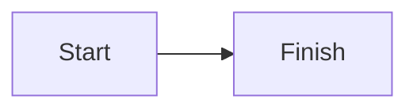

# Kitchen Sink

An opening paragraph with **bold words**, *slanted words*, `inline code`
and a [link to the guide](guide.md).

## Lists

- first bullet
- second bullet
  - nested bullet

1. step one
2. step two

- [x] finished task
- [ ] open task

## Table

| Fruit | Count |
| :--- | ---: |
| apple | 3 |
| pear | 12 |

## Code

```rust
fn answer() -> u32 {
    42
}
```

> A quoted remark.

## Math

Inline $a^2 + b^2 = c^2$ in a sentence.

$$
\int_0^1 x^2 \, dx
$$

## Diagram



## Footnote

A claim with a note.[^1]

[^1]: The note itself.

~~struck out~~ and :pushpin: at the end.
